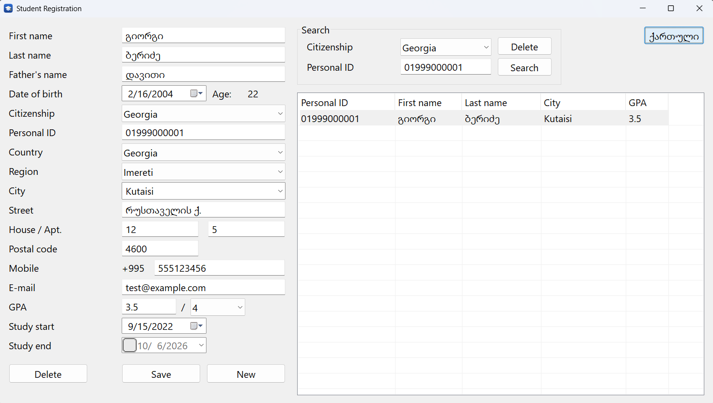
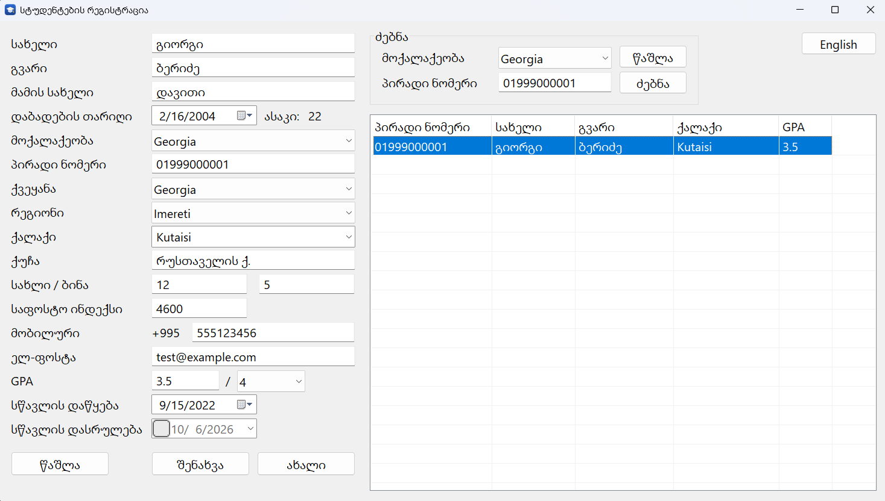

# Student Registration

A Windows desktop application for registering students, written entirely in **x86 Assembly (MASM)**, with no C runtime and no frameworks. Data is stored in **SQLite**.



> Part of a learning series: the same project is built in Assembly (v1), C (v2) and C++ (v3).

## Features

- Register, search, view, edit and delete students
- Search by citizenship and personal ID: instant even with **1,000,000 students** in the database (indexed lookup)
- Cascading Country → Region → City lists: 250 countries, 4,000+ regions, 150,000+ cities
- Phone country code filled in automatically from the selected country
- Bilingual interface (Georgian / English), switchable while the program runs
- Input validation: Georgian 11-digit personal ID, e-mail format, GPA within its grading scale, dates
- GPA stored together with its grading scale (4, 5, 10, 20, 100), so students from different countries can be compared
- Resizable window, High-DPI aware, keyboard friendly (Tab, Enter to search, Delete to remove)
- Right-click menu on search results (Open / Delete)

## Download and run

1. Download the latest `.zip` from [Releases](../../releases)
2. Extract it anywhere and run `StudentRegistration v1.exe`

No installation needed. Requires Windows 10 or 11. The students database (`data\students.db`) is created automatically on first run.

## Build from source

Requirements: Visual Studio 2022 or newer with the **Desktop development with C++** workload (it includes MASM).

1. Clone the repository and open `StudentRegistration v1.slnx`
2. Select the **x86** platform and build. `lib\` already contains `sqlite3.dll` and its import library `sqlite3.lib`
3. Prepare the countries database (one time, see below) and put `geo.db` into `data\`

### Countries database (`data\geo.db`)

`geo.db` is generated from the [countries-states-cities-database](https://github.com/dr5hn/countries-states-cities-database) project:

1. Download `sqlite-world.sqlite3.gz` from that project's Releases and extract it to `data\world.sqlite3`
2. Download the SQLite command-line tools (`sqlite3.exe`) from [sqlite.org](https://sqlite.org/download.html) into `tools\`
3. In the `tools` folder run:
   ```
   .\sqlite3.exe ..\data\geo.db ".read make_geo.sql"
   ```

### Test data (optional)

Generates 1,000,000 fictional students (takes about 10 seconds; personal IDs are unique, every 50th student is a foreign citizen):

```
.\sqlite3.exe ..\data\students.db ".read gen_students.sql"
```

**Warning:** this recreates the `students` table, so existing records are deleted.

## Project structure

```
src\           Assembly source: only main.asm is assembled, everything else is included
lib\           SQLite (sqlite3.dll, sqlite3.def, sqlite3.lib)
tools\         SQL scripts: geo.db preparation and the test data generator
res\           Application icon
docs\          Screenshots
data\          Databases (not stored in the repository)
app.rc         Icon and version information
app.manifest   Enables modern Windows controls (Common Controls 6)
```

How the program is organized: [ARCHITECTURE.md](ARCHITECTURE.md)

## Note

This is an educational and portfolio project. It is not intended for storing real personal data: the database is not encrypted and there is no user authentication.

## Licenses

- Source code: [MIT](LICENSE), © 2026 Levan Kotorashvili
- [SQLite](https://sqlite.org): public domain
- Countries, regions and cities: [countries-states-cities-database](https://github.com/dr5hn/countries-states-cities-database) by dr5hn, licensed under [ODbL-1.0](https://opendatacommons.org/licenses/odbl/1-0/). `geo.db` is derived from it and is distributed under the same license.

---

## ქართულად

სტუდენტების რეგისტრაციის Windows-ის პროგრამა, დაწერილი სრულად x86 ასემბლერზე (MASM), SQLite ბაზით.



**შესაძლებლობები:** სტუდენტის რეგისტრაცია, ძებნა, ნახვა, რედაქტირება და წაშლა; მყისიერი ძებნა მილიონ ჩანაწერში; ქვეყანა → რეგიონი → ქალაქის სიები (250 ქვეყანა, 150 000+ ქალაქი); ქართული და ინგლისური ინტერფეისი; ველების შემოწმება (ქართული პირადი ნომერი, ელ-ფოსტა, GPA სკალის მიხედვით, თარიღები).

**გაშვება:** [Releases](../../releases)-დან ჩამოტვირთე zip, გახსენი და გაუშვი `StudentRegistration v1.exe`. ინსტალაცია არ სჭირდება.

ეს სასწავლო პროექტია და რეალური პერსონალური მონაცემების შესანახად არ არის განკუთვნილი.
